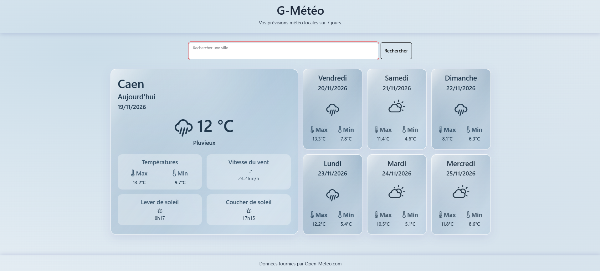

# G-Météo – Application météo

Application web permettant de consulter les conditions météorologiques actuelles et les prévisions sur 7 jours pour la ville de son choix.
G-Météo propose une interface responsive et dynamique, avec une présentation visuelle qui s'adapte aux conditions météorologiques.

## Aperçu



## Fonctionnalités

- Recherche météorologique par nom de ville.
- Affichage des conditions météorologiques actuelles.
- Prévisions météorologiques sur 7 jours.
- Affichage des températures maximales et minimales.
- Informations complémentaires : vitesse du vent, heures de lever et de coucher du soleil.
- Adaptation de l'interface aux conditions météorologiques.
- Affichage des données locales grâce à la prise en compte du fuseau horaire.
- Interface responsive adaptée aux différents formats d'écran.
- Gestion des erreurs et des recherches infructueuses.

## Technologies utilisées

| Technologie    | Utilisation                                           |
| -------------- | ----------------------------------------------------- |
| HTML5          | Structure et sémantique de l'application              |
| CSS3           | Mise en page, effets visuels et design responsive     |
| Bootstrap 5    | Grille responsive et composants utilitaires           |
| JavaScript     | Logique applicative et manipulation du DOM            |
| Open-Meteo API | Géolocalisation des villes et données météorologiques |
| Weather Icons  | Icônes météorologiques                                |

## API et ressources

- [Open-Meteo](https://open-meteo.com/) – API de géocodage et données météorologiques.
- [Weather Icons](https://erikflowers.github.io/weather-icons/) – Bibliothèque d'icônes météorologiques.
- [Bootstrap](https://getbootstrap.com/) – Framework CSS.

## Installation

Aucune installation de dépendance n'est nécessaire.

1. Cloner le dépôt :

   ```bash
   git clone https://github.com/vogel-gregory/g-meteo.git
   ```

2. Accéder au dossier du projet :

   ```bash
   cd g-meteo
   ```

3. Ouvrir le fichier `index.html` dans un navigateur.

Il est également possible d'utiliser l'extension **Live Server** de Visual Studio Code pour lancer l'application en local.

## Structure du projet

```text
g-meteo/
│
├── css/
│   ├── bootstrap.min.css
│   ├── styles.css
│   ├── weather-icons.css
│   └── weather-icons.min.css
│
├── font/
│   ├── weathericons-regular-webfont.eot
│   ├── weathericons-regular-webfont.svg
│   ├── weathericons-regular-webfont.ttf
│   ├── weathericons-regular-webfont.woff
│   └── weathericons-regular-webfont.woff2
│
├── js/
│   └── script.js
│
├── screenshots/
│   └── g-meteo.png
│
├── index.html
└── README.md
```

## Compétences mises en pratique

Ce projet m'a permis de consolider et de mettre en application plusieurs compétences acquises au cours de ma formation Développeur Web et Web Mobile :

- **HTML5** : structuration sémantique et accessibilité.
- **CSS3** : responsive design, Flexbox, variables CSS, effets visuels et gestion des différentes ambiances météorologiques.
- **Bootstrap** : utilisation du système de grille et des classes utilitaires.
- **JavaScript** : fonctions, tableaux, objets, boucles, conditions et manipulation du DOM.
- **Programmation asynchrone** : utilisation de `fetch()`, des promesses et de `async/await`.
- **API REST** : récupération, traitement et exploitation de données externes au format JSON.
- **Gestion des erreurs** : validation des réponses HTTP et contrôle des données reçues.
- **Dates et heures** : manipulation des objets `Date` et prise en compte des fuseaux horaires.
- **Organisation du code** : séparation des ressources HTML, CSS et JavaScript.

## Auteur

**Grégory Vogel**

Développeur Web en reconversion – Formation DWWM (Développeur Web et Web Mobile).

Projet réalisé dans le cadre de ma formation et de la constitution de mon portfolio.
